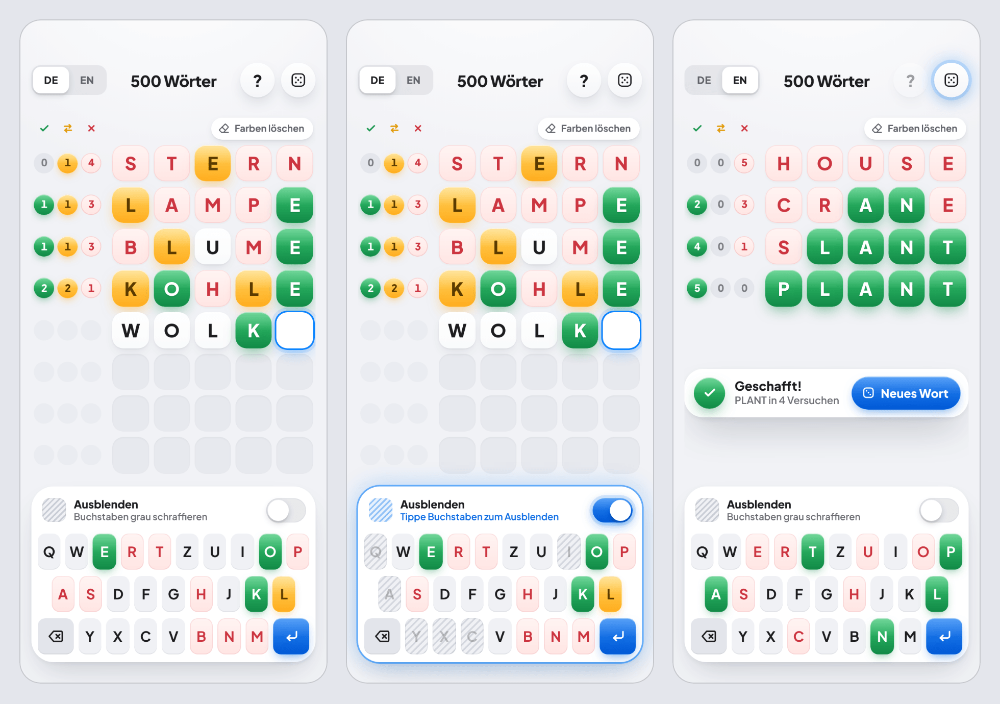

# 500 Wörter

Ein Wort-Ratespiel fürs iPhone nach dem Prinzip von [word500.com](https://word500.com), als installierbare Web-App (PWA) im Look von iOS-Widgets. Gesucht ist ein Wort mit 5 Buchstaben, auf Deutsch oder Englisch. Läuft komplett offline, ohne Konto und ohne Tracking.



## So wird gespielt

- Gesucht ist ein zufälliges Wort mit 5 Buchstaben. Du hast 8 Versuche.
- Nach jedem Versuch stehen links nur drei Zahlen: **richtig** (✓, richtige Stelle), **im Wort** (⇄, andere Stelle) und **falsch** (✕, kommt nicht vor). Welche Buchstaben gemeint sind, verrät das Spiel nie.
- Tippe auf eine Kachel, um dir Notizen zu machen: ohne → Falsch → Im Wort → Richtig → ohne. Die Tastatur zeigt pro Buchstabe deine stärkste Markierung.
- Mit dem Schalter **Ausblenden** schraffierst du Buchstaben, die du ausschliessen willst (siehe unten).
- Der **Würfel** oben rechts zieht ein neues Wort. **DE | EN** wechselt die Sprache. Jede Sprache hat ihre eigene Runde.

### Ausblenden

- **Schalter an:** Tippe auf eine Buchstaben-Taste, um sie grau zu schraffieren. Nochmals tippen nimmt die Schraffur weg. In diesem Modus wird nicht geschrieben, die Tastatur-Karte leuchtet blau.
- **Schalter aus:** Schraffierte Tasten bleiben schraffiert und sind gesperrt. Antippen tut nichts, auch die physische Tastatur ignoriert diese Buchstaben. Alle anderen Tasten schreiben normal, schon getippte Buchstaben bleiben stehen. Die Unterzeile zeigt, wie viele Buchstaben ausgeblendet sind, z. B. «3 Buchstaben ausgeblendet».
- **Zurückholen:** Schalter wieder an und die Taste nochmals antippen.
- **Neues Wort** (Würfel oder nach Sieg und Niederlage): Die Schraffur wird geleert, der Schalter geht aus. Deutsch und Englisch haben je ihre eigene Schraffur.

## Lokal starten

Voraussetzung: [Node.js](https://nodejs.org) 24 LTS (mindestens 22.18).

```bash
npm install
npm run dev        # Entwicklungsserver auf http://localhost:5173
npm test           # alle Tests (Vitest)
npm run build      # Typprüfung und Produktions-Build nach dist/
npm run preview    # den Build lokal ansehen, inklusive Offline-Modus
```

Zum Testen auf dem iPhone im selben WLAN: `npm run dev -- --host` und die angezeigte Netzwerk-Adresse in Safari öffnen.

## Wortlisten neu erzeugen

Die 500 Lösungswörter (250 Deutsch, 250 Englisch) stehen fest in `src/data/solutions.json`. Die Listen der erlaubten Rateversuche werden aus freien Wörterbüchern erzeugt:

```bash
npm run words
```

Das Script `scripts/build-wordlists.mjs` schreibt `src/data/valid-de.json` (rund 3850 Wörter, Schweizer Wörterbuch, ß wird zu SS, Wörter mit Umlauten fallen weg) und `src/data/valid-en.json` (rund 12 650 Wörter). Lösungswörter sind immer gültig. Die erzeugten Dateien gehören ins Repo.

## App-Icons neu erzeugen

Die Vorlagen liegen in `design/`: `app-icon.png` und `app-icon-maskable.png` (je 1024 × 1024 px, ohne Transparenz). Daraus erzeugt

```bash
npm run icons
```

in `public/` das iOS-Icon (180 px), die PWA-Icons (192 und 512 px), das maskierbare Icon (512 px, aus der maskierbaren Vorlage) und das Favicon (16, 32 und 48 px). Die erzeugten Dateien gehören ins Repo.

## Deployen auf GitHub Pages

Der Workflow `.github/workflows/deploy.yml` testet, baut und veröffentlicht die App **bei jedem Push auf `main`** automatisch. Solange GitHub Pages noch nicht eingerichtet ist, endet er mit einem Hinweis statt mit einem Fehler.

Einmalig einrichten, am besten in dieser Reihenfolge:

1. **Standard-Branch:** Unter **Settings → General → Default branch** `main` wählen. GitHub Pages veröffentlicht nur vom Standard-Branch.
2. **Repo öffentlich machen:** Mit einem Gratis-Konto funktioniert GitHub Pages nur bei öffentlichen Repos (**Settings → General → Danger Zone → Change visibility**).
3. **Pages einschalten:** Unter **Settings → Pages → Build and deployment → Source** «**GitHub Actions**» wählen.
4. **Ersten Deploy starten:** **Actions → Deploy auf GitHub Pages → Run workflow**. Danach veröffentlicht jeder Push auf `main` von selbst.

Die App ist dann unter `https://<benutzername>.github.io/<repo-name>/` erreichbar. Den Pfad `/<repo-name>/` setzt der Workflow automatisch über die Umgebungsvariable `BASE_PATH`. Ein zweiter Workflow (`test.yml`) prüft Tests und Build bei Pull Requests und auf anderen Branches.

## Auf dem iPhone installieren

1. Die Adresse der App in **Safari** öffnen.
2. Unten auf **Teilen** tippen (Quadrat mit Pfeil nach oben).
3. **Zum Home-Bildschirm** wählen und mit **Hinzufügen** bestätigen.

Die App startet dann ohne Safari-Leisten wie eine normale App und funktioniert auch offline. Der Spielstand bleibt auf dem Gerät gespeichert, Updates lädt sie beim nächsten Öffnen von selbst.

## Projektstruktur

```
src/
  game/          Spiellogik ohne Oberfläche: Wertung, Shuffle-Bag, Reducer, Speichern
  components/    Kopfzeile, Spielfeld, Zeile, Kachel, Zahlen-Chips, Tastatur, Schalter,
                 Ergebnis-Karte, Meldung, Dialog
  styles/        tokens.css (Design-Tokens) und app.css
  data/          Lösungswörter und Listen gültiger Rateversuche
public/          erzeugte App-Icons und Favicon
scripts/         Scripts für Wortlisten und Icons
design/          App-Icon-Vorlagen, Referenzbilder, Quellen aus dem Design-Canvas, Inspiration
```

Der Spielstand liegt in `localStorage` unter dem Schlüssel `500w:v1`.

## Lizenz-Hinweise

- **Deutsche Wortliste:** `src/data/valid-de.json` ist aus dem GPL-lizenzierten Wörterbuch [`@cspell/dict-de-ch`](https://github.com/streetsidesoftware/cspell-dicts/tree/main/dictionaries/de_CH) abgeleitet (GPL-3.0-or-later, basiert auf igerman98 von Björn Jacke). Für diese Datei gelten die Bedingungen der GPL.
- **Englische Wortliste:** abgeleitet aus [`an-array-of-english-words`](https://github.com/words/an-array-of-english-words) (MIT).
- **Schrift:** [Plus Jakarta Sans](https://fonts.google.com/specimen/Plus+Jakarta+Sans) über Fontsource (SIL Open Font License 1.1).
